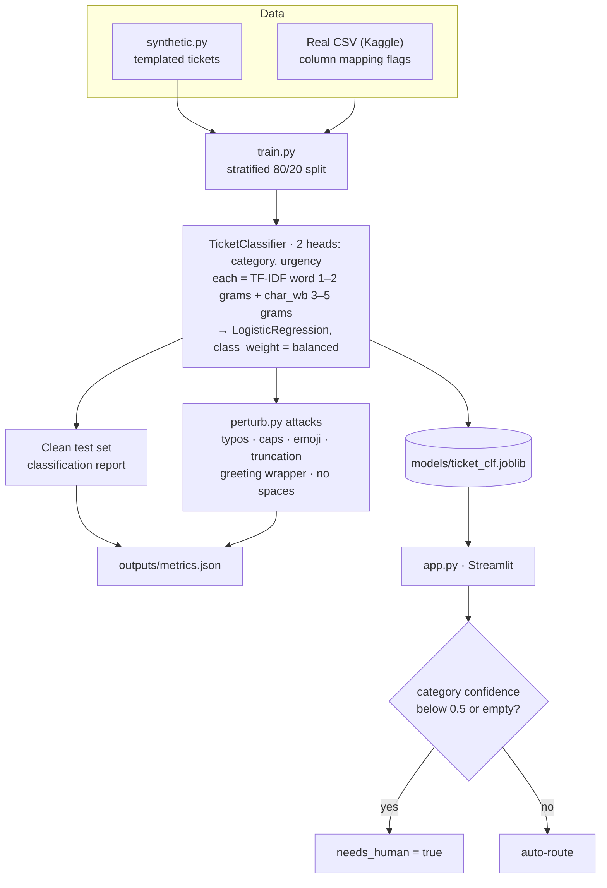

# 05 · Support Ticket Classifier

> Auto-sort support tickets by **category** and **urgency**, then attack the model with messy real-world input.

## Problem
Misrouted tickets cost support teams hours and annoy customers. Routing them automatically, and handing uncertain ones to a human, cuts first-response time.

## Architecture

_PNG export for slides/resume: [docs/architecture.png](docs/architecture.png)_

## Approach
- Two heads (category, urgency), each a **TF-IDF word (1–2) + char_wb (3–5) n-gram → LogisticRegression** pipeline (scikit-learn), `class_weight="balanced"`.
- Char n-grams are what keep the model working on typos and squashed text.
- **Robustness suite** (`tickets/perturb.py`): typos, ALL CAPS, emoji noise, truncation, greeting wrappers, no spaces. Macro-F1 is reported per perturbation.
- **Abstention**: category confidence < 0.5 or an empty ticket → `needs_human=True`.
- Ships with a synthetic data generator so it runs immediately. **Swap in a real dataset** for the portfolio version.

### Real data
Any labelled ticket CSV works. Search Kaggle for "customer support ticket dataset" and map the columns:
```bash
python train.py --data data/tickets.csv --text-col "Ticket Description" --category-col "Ticket Type" --urgency-col "Ticket Priority"
```

## Result
_Run `python train.py` and paste the clean vs. perturbed macro-F1 table here._

## What broke
_e.g. "`no_spaces_punct` dropped category F1 from 0.97 → 0.41 with word-only TF-IDF → adding char n-grams recovered it to 0.88."_

## Run
```bash
pip install -r requirements.txt
python train.py
streamlit run app.py
pytest -q
```
